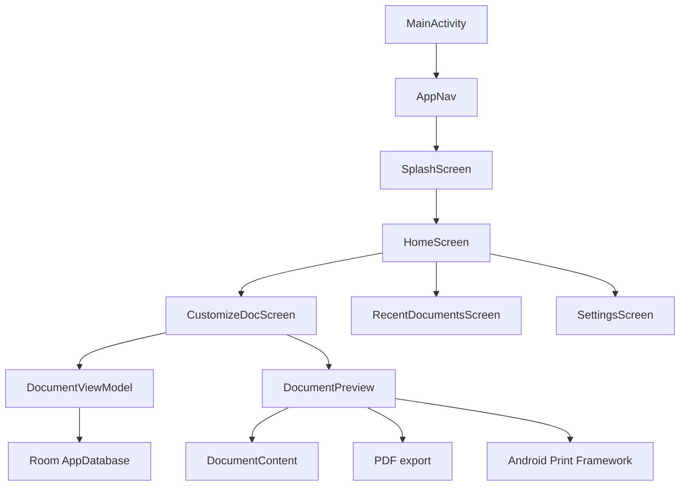

<div align="center">

# AGC EasyDoc

### Create, save, export, and print academic documents on Android.

AGC EasyDoc is a focused document builder for academic notices, letters, applications, and other formal documents that need a consistent layout.


</div>

---

## Why this exists

Formal academic documents often reuse the same institutional header, reference details, body formatting, tables, and signature layout. Rebuilding that layout in a general-purpose editor is slow, especially on a mobile device.

AGC EasyDoc turns that repeated work into a guided editor. A document can be created on an Android device, saved locally, reopened later, exported to Downloads, or sent to the Android print framework.

The project is designed around a small, predictable workflow:

```text
Open app -> Create document -> Customize -> Save -> Export or print
```

There is no account system, sign-in flow, advertising SDK, save quota, analytics service, or tracking endpoint.

## What it provides

| Capability | Description |
|------------|-------------|
| Mobile document editor | Edit the document structure with Compose-based controls |
| Academic layout | Use an institutional header, body sections, images, tables, and signatures |
| Local persistence | Save documents in a Room database on the device |
| PDF generation | Create an A4 PDF and write it to the Android Downloads collection |
| Android printing | Send the rendered document to an installed Android print service |
| Offline workflow | Create, edit, save, and reopen documents without an account or network access |

## Features

### Header

- Document title
- Department or club name
- Optional reference number
- Optional date
- Institutional header artwork
- Auto-sized header text for longer titles and department names

### Body sections

- Start with a body section and add more when needed
- Edit each section independently
- Change font size from 12sp to 24sp
- Toggle bold text
- Choose left, center, right, or justified alignment
- Remove extra sections while keeping at least one section available

### Images

- Select images from the Android document picker
- Add up to four images to a document
- Preview images in a two-column grid
- Remove individual images
- Resize large images before preview and export to reduce memory usage
- Handle common image rotation metadata when loading images

### Tables

- Enable or disable a table in the document
- Set a table title
- Choose the number of rows and columns
- Edit every cell directly
- Use the table in the rendered document preview and PDF output

### Signatures

- Add multiple signature blocks
- Enter an authority label such as Dean or Coordinator
- Align each signature left, center, or right
- Adjust the signature font size
- Render two left and right signatures on one row when the layout allows it

### Recent documents

- Save documents locally
- View the ten most recently modified documents
- Reopen a document for editing
- Delete a document after confirmation
- Keep document content, images, tables, and signatures together in the saved record

## Quick start

### Requirements

- Android Studio
- Android SDK 36
- A full JDK with a Java compiler
- Android Gradle Plugin 9.5.0
- Kotlin 2.2.10
- An Android device or emulator

The module declares `minSdk = 24`, `targetSdk = 36`, and `compileSdk = 36`. Android 12 or newer is recommended for the current application entry and UI path.

### Clone the repository

```bash
git clone https://github.com/iabhnv19/AGCEasyDoc.git
cd AGCEasyDoc
```

### Open in Android Studio

1. Open Android Studio.
2. Select **Open** and choose the repository directory.
3. Wait for Gradle sync to finish.
4. Connect a device or start an emulator.
5. Select the `app` run configuration.
6. Press **Run**.

The app starts with a splash screen and then opens directly to the home screen. No registration or sign-in is required.

## Build and test

### Windows

Build a debug APK:

```bat
gradlew.bat assembleDebug
```

Run local unit tests:

```bat
gradlew.bat testDebugUnitTest
```

Run all standard verification tasks:

```bat
gradlew.bat check
```

### macOS and Linux

```bash
./gradlew assembleDebug
./gradlew testDebugUnitTest
./gradlew check
```

The debug APK is generated at:

```text
app/build/outputs/apk/debug/app-debug.apk
```

The project includes local JVM tests and Android instrumented tests. The default tests are a starting point for contributors; feature-specific tests should be added as behavior is expanded.

### Build variants

| Variant | Purpose |
|---------|---------|
| `debug` | Local development and device testing |
| `release` | Minified release build using the module ProGuard configuration |

Build a release APK with:

```bash
./gradlew assembleRelease
```

For Windows, use `gradlew.bat assembleRelease`.

Release signing is intentionally not included in the repository. Configure signing locally or through a private CI secret before publishing a release artifact.

## How to use

### Create a document

1. Open AGC EasyDoc.
2. Select **Create New Document**.
3. Open the **Header** section.
4. Enter a title and department or club name.
5. Enable reference number and date fields if they are needed.

### Add content

1. Open the **Body** section.
2. Enter the first section of text.
3. Choose the alignment, font size, and bold state.
4. Select **Add Body Section** for more content.
5. Use **Images**, **Table**, and **Signatures** for optional content.

### Save and reopen

1. Select **Save** in the top-right corner.
2. Wait for the confirmation message.
3. Return to the home screen.
4. Select **Recent Documents**.
5. Tap a document to reopen it.

The save operation is local and has no account requirement or save limit.

### Delete a saved document

1. Open **Recent Documents**.
2. Select the delete icon on a document.
3. Confirm the deletion.

Deletion removes the saved Room record from the device.

## Document model

The editor represents a document with these main fields:

```text
DocumentData
├── title
├── department
├── refNo
├── date
├── bodyBlocks[]
├── images[]
├── table?
├── signatures[]
└── signatureFontSize
```

Each body block stores:

```text
BodyBlock
├── text
├── fontSize
├── isBold
└── alignment
```

Each signature block stores its text and alignment. Table data stores the title, dimensions, and a two-dimensional list of cell values.

Complex fields are serialized to JSON before being stored in the `saved_documents` Room table. They are reconstructed when a saved document is loaded.

## Export and printing

The document preview renders a printable version using the application layout and Liberation Serif font resources (metric-compatible with Times New Roman).

### PDF export

When the export action is used:

1. The document is rendered to an A4-sized bitmap.
2. The bitmap is converted into a PDF.
3. PDF metadata is written with the document title and application information.
4. The PDF is copied to the Android Downloads collection.
5. Temporary cache files are removed.

Generated filenames use this pattern:

```text
EasyDoc_<timestamp>.pdf
```

### Printing

The same rendered document is passed to the Android Print Framework with A4 print attributes. The final printer selection and available options depend on the print services installed on the device.

## Privacy and permissions

AGC EasyDoc does not have an account system and does not collect account credentials.

### Local data

- Saved documents are stored in the local Room database.
- Image URI references are stored with the document record.
- Images are processed locally for previews and exports.
- Clearing app data or uninstalling the app removes local document data unless Android backup restores it.

### Network and tracking

- The app does not declare the Android `INTERNET` permission.
- No advertising SDK is included.
- No analytics service is included.
- No Google Sheets logger is included.
- No external account or sign-in endpoint is used.

### Third-party libraries

The app uses open-source libraries for Android UI, navigation, local storage, PDF creation, image processing, and serialization. Their licenses and versions should be reviewed before distributing a release build.

## Architecture



### Main responsibilities

| Component | Responsibility |
|-----------|----------------|
| `MainActivity` | Configures the activity window and starts Compose content |
| `AppNav` | Defines application navigation and shares the document view model |
| `DocumentViewModel` | Owns the editable document state and save/load operations |
| `AppDatabase` | Provides the Room database instance |
| `DocumentDao` | Reads, inserts, updates, and deletes saved documents |
| `CustomizeDocScreen` | Provides the document editing controls |
| `DocumentPreview` | Compresses images, previews the document, exports, and prints |
| `DocumentContent` | Renders the screen document layout |
| `PrintableDocument` | Renders the print and PDF layout |
| `ImageUtils` | Decodes, rotates, resizes, and compresses selected images |
| `SettingsScreen` | Displays application information and contact actions |

## Project structure

```text
AGCEasyDoc/
├── app/
│   ├── build.gradle.kts
│   ├── proguard-rules.pro
│   └── src/
│       ├── androidTest/                         # Instrumented Android tests
│       ├── main/
│       │   ├── AndroidManifest.xml
│       │   ├── java/com/example/agceasydoc/
│       │   │   ├── data/                        # Room entities, DAO, and document rendering
│       │   │   ├── nav/                         # Navigation graph
│       │   │   ├── onbording/                   # Splash screen
│       │   │   ├── print/                       # Image, bitmap, PDF, and print helpers
│       │   │   ├── screens/                     # Compose screens and document UI
│       │   │   ├── ui/theme/                    # Compose theme and typography
│       │   │   ├── MainActivity.kt
│       │   │   ├── MyApplication.kt
│       │   │   └── Screen.kt
│       │   └── res/                             # Fonts, icons, drawables, themes, and strings
│       └── test/                                # JVM unit tests
├── gradle/
│   ├── libs.versions.toml                       # Dependency and plugin versions
│   └── wrapper/                                  # Gradle wrapper files
├── .gitignore
├── build.gradle.kts
├── gradle.properties
├── gradlew
├── gradlew.bat
├── LICENSE
├── README.md
└── settings.gradle.kts
```

## Dependencies

The application uses the following main libraries:

| Library | Purpose |
|---------|---------|
| Jetpack Compose | Declarative Android UI |
| Material 3 | UI components and theming |
| Navigation Compose | Screen navigation |
| Lifecycle | View model and lifecycle integration |
| Room | Local document database |
| Kotlin Serialization | JSON conversion for document data |
| iText PDF | PDF metadata and PDF document handling |
| Android Print Framework | Printing to installed Android print services |
| AndroidX Core and Activity | Android platform integration |

Dependency versions are maintained in `gradle/libs.versions.toml` where possible. Direct module dependencies are listed in `app/build.gradle.kts`.

## Troubleshooting

<details>
<summary><b>Gradle says that no Java compiler was found</b></summary>

Install a full JDK rather than a JRE. Confirm that `JAVA_HOME` points to the JDK directory and that `java --version` and `javac --version` work in the same terminal.
</details>

<details>
<summary><b>Gradle fails with an unsupported Java version</b></summary>

Use a Java version supported by the installed Android Gradle Plugin and Kotlin tooling. Android Studio's bundled JDK is usually the easiest option. If the bundled JDK is too new for a dependency, configure the project to use a compatible JDK.
</details>

<details>
<summary><b>The app does not install on my device</b></summary>

- Confirm that the device meets the module minimum SDK.
- Enable Developer Options and USB debugging.
- Check that the device is visible in Android Studio.
- Try an emulator with a current Android image.
- Verify that the `app` run configuration is selected.
</details>

<details>
<summary><b>Images take time to appear</b></summary>

Images are decoded and resized before they are displayed. Large images may take longer and consume more memory. Wait for the compression indicator to finish before exporting or printing.
</details>

<details>
<summary><b>A saved document is not visible</b></summary>

Documents are stored per device. Confirm that the document was saved successfully, return to the home screen, and open Recent Documents. Clearing app data or uninstalling the app removes the local database.
</details>

<details>
<summary><b>The PDF is not visible in a file manager</b></summary>

The app writes exported PDFs to the Android Downloads collection. Open the system Files app and check Downloads. Device manufacturers may display this collection under a different label.
</details>

<details>
<summary><b>Printing is unavailable</b></summary>

Android only displays print destinations provided by installed print services. Install or enable a compatible print service, then try the print action again.
</details>

## Known limitations

- Documents are stored locally and are not synchronized between devices.
- There is currently no import format for existing Word or PDF documents.
- The editor supports up to four images per document.
- The document layout is optimized for the included academic template rather than arbitrary page designs.
- Release signing configuration is not included in the public repository.
- The test suite is currently a starter suite and should grow with new features.

## Contributing

Issues and pull requests are welcome.

### Before opening an issue

Include:

- Android version and device or emulator model
- App version or commit
- Steps to reproduce the problem
- Expected behavior
- Actual behavior
- Relevant logs or screenshots, after removing private information

### Before opening a pull request

1. Keep the change focused.
2. Follow the surrounding Kotlin and Compose style.
3. Do not add credentials, private URLs, generated build output, or local configuration.
4. Update the README when user-facing behavior changes.
5. Add or update tests where practical.
6. Run the relevant Gradle checks.
7. Explain important design or compatibility decisions in the pull request description.

Use clear commit messages such as:

```text
feat: add document table editing
fix: handle rotated image previews
docs: update build instructions
test: cover document serialization
```

## License

AGC EasyDoc is released under the [GNU Affero General Public License v3.0 (AGPLv3)](LICENSE).

## Developer

Developed By
<div align="center">

<table>
  <tr>
    <td align="center">
      <a href="https://github.com/iabhnv19">
        
        <br />
        <strong>Abhinav</strong>
        <br />
        @iabhnv19
      </a>
    </td>
  </tr>
</table>
</div>

<div align="center">

**Built with Kotlin and Jetpack Compose for simple academic document creation.**

</div>
